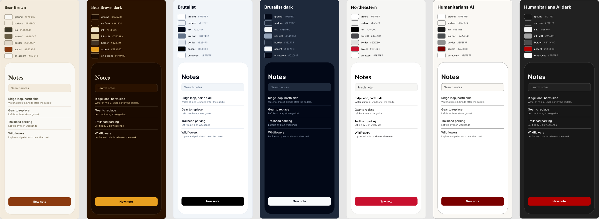
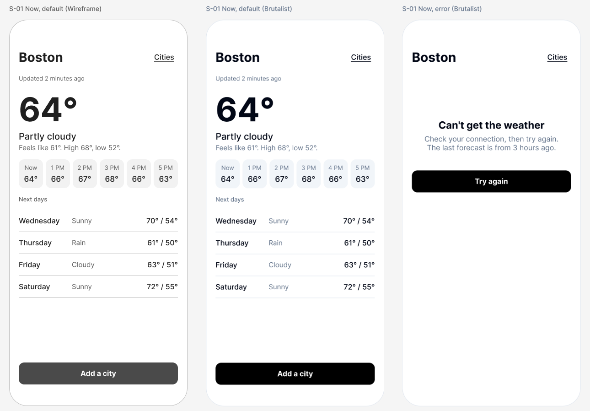

# figma-appdesigner

A Claude skill for designing a phone app by talking, drawn in Figma, with a paper trail.

You say what the app is for. Claude writes a short brief, maps the screens, and draws them in Figma (through the Figma MCP): first as plain wireframes, then in your colors. You ask for changes in plain words and it makes them, keeping a record of what you asked. It measures its own drawing against a written rulebook (too small to tap, too faint to read, a missing empty state), and you accept or reject each design. Accepted designs are handed to Claude Code or Codex as small build briefs. Nothing here writes app code.

It is the sibling of [figma-webdesigner](https://github.com/nikbearbrown/figma-webdesigner), which redesigns a website that already exists. Same colors, same record-keeping, same rule that only a person approves.



## Get started

```bash
cd figma-appdesigner
./fad help
```

`./fad help` checks what you have and what you are missing (git, Claude Code, the Figma connection, a design folder) and names the one thing to do next. When it says you are ready, open Claude Code in this folder and type `tutorial`. See [tutorial/README.md](tutorial/README.md).

## Tutorials

Three ready-made tutorials, one for each of the commonest kinds of small app. Each starts you with an example brief and a proposed set of screens, and shows the first screen drawn for real.

| Tutorial | Start it | It teaches |
|---|---|---|
| [A to-do list](tutorial/apps/to-do/README.md) | `./fad init "Today List" --tutorial to-do` | Lists, the empty state, and how big a thing to tap must be |
| [A weather app](tutorial/apps/weather/README.md) | `./fad init "Sky Today" --tutorial weather` | Showing numbers at a glance, and what a screen says with no data |
| [A chat app](tutorial/apps/chat/README.md) | `./fad init "Hello Chat" --tutorial chat` | A text box that stays reachable, and two speakers told apart without color |



The wireframe and the styled screen are the same drawing; only the color mode of the frame differs. When this screen was measured, the check found the six hour labels too faint to read comfortably (4.34:1, where body text needs 4.5:1). Fixing that is the tutorial's first request.

| Command | What it does |
|---|---|
| `./fad help` | Checks your setup, names the next step |
| `./fad check [--json]` | The checks alone |
| `./fad init "<app name>"` | Starts a design folder (`--platform ios\|android\|both`, `--palette <id>`) |
| `./fad tutorial` | Shows the seven steps and the current one |
| `./fad tutorials [name]` | The ready-made tutorials: `to-do`, `weather`, `chat` |
| `./fad palettes [id]` | The four default color sets, or one in full with its contrast worked out |
| `./fad devices` | The screen sizes, safe areas and smallest tap targets designs are drawn to |
| `./fad screens` | Your app's screens and how they connect, with anything unreachable flagged |
| `./fad templates [kind]` | Open-licensed templates and design kits for common kinds of app, with credits |
| `./fad approve <D-id>` (also `reject`, `defer`) | **You** decide a design, in your own terminal |
| `./fad ledger verify` | Checks the record has not been altered |
| `./fad install` | Links this folder as a Claude skill for every project |

Needs Python 3.9+ (standard library only) and git.

## Colors

Screens are drawn in one of four default color sets, each read from the site it is named for:

| id | Read from | Ground | Ink | Accent | Dark mode |
|---|---|---|---|---|---|
| `bear-brown` (default) | [bearbrown.co](https://www.bearbrown.co/) | `#FAF9F5` | `#3D3929` | `#8B3A0F` | yes |
| `brutalist` | [brutalist.art](https://www.brutalist.art/) | `#FFFFFF` | `#020817` | `#000000` | yes |
| `northeastern` | [Northeastern Brand Center, color](https://brand.northeastern.edu/design-and-experiences/design/color/) | `#FFFFFF` | `#000000` | `#C8102E` | no |
| `humanitarians` | [humanitarians.ai](https://www.humanitarians.ai/) | `#FFFFFF` | `#1B1B1B` | `#7A0000` | yes |

All four go into the Figma file as modes of one set of color variables, so "show me this in Northeastern colors" is a switch, not a redraw. `./fad palettes bear-brown` prints every role and works out the contrast of each text and button pairing; two pairings are under their minimum and are marked `LOW`. The values live in [palettes/palettes.json](palettes/palettes.json), the same file figma-webdesigner ships.

The Northeastern set is the university's published palette. It is not permission to use its name or logos.

## How it works

1. **Brief.** What the app does, for whom, the three things a person must be able to do, which phone, which colors, who may approve.
2. **Screen map.** Each screen, what a person does there, where it leads, and which states it needs (empty, loading, error).
3. **Kit.** Color and type variables and a few components in a new Figma file.
4. **Wireframes.** The first screen as boxes and real words, at phone size.
5. **Styled screens, and requests.** Your colors go on. You ask for changes; each one is recorded in your words and then made.
6. **Check.** The drawing is measured: tap targets, contrast, text size, safe areas, missing states. Each finding cites a rule.
7. **Decisions.** Each design is written up with the options passed over. Only a human can approve one.
8. **Handoff.** Approved designs become briefs for Claude Code or Codex, one branch per design.

Records live in plain files (`brief.yaml`, `screens.json`, `decisions/D-NNNN.json`, an append-only `ledger.jsonl`), so the history can be diffed and reviewed in Git.

## Templates

`./fad templates` lists free, open templates for common kinds of app, and `./fad templates chat` (or `weather`, `flutter`, `wireframe`, any word) narrows it.

| Catalog | Entries | What the licences allow |
|---|---|---|
| [Code](templates/code-templates.json): open-source apps and starter kits on GitHub, in SwiftUI, Compose, React Native, Flutter, Kotlin Multiplatform and Ionic | 291 | 208 copy with credit, 83 copyleft (your app must be shared the same way) |
| [Design](templates/design-templates.json): kits and files to open in Figma, icon sets, design systems | 68 | 42 CC BY 4.0, the rest MIT, Apache, BSD, ISC, CC0 or public domain |

Only works with a confirmed licence that allows reuse are published here, and each has a credit line: [templates/CREDITS.md](templates/CREDITS.md) lists them all. The search found 73 more (30 repositories with no usable licence, 38 design files whose licence could not be read, and 5 under a publisher's own terms, Apple's design kits among them). Those are kept out of this repository. This tool links to templates; it does not contain copies of them.

How far to trust them, as of 2026-11-10:

- **Code:** every repository was looked up twice through GitHub's API. All exist, and licence, archived flag and stars match. What screens each app really has, and whether it leans on a paid service, was not checked.
- **Design:** the GitHub-hosted entries were checked the same way. For Figma Community files the licence line was read from the file page where the page would open; Figma's human-verification check stopped the rest, and those are not published.
- **Thin spots:** nothing in the design catalog for real estate, tickets, journaling, meditation or marketplace; few or no freely usable code templates for job boards, meditation, classifieds and ride hailing.

Neither list is an audit. Open a template's licence before you build on it. Nothing in the catalogs is downloaded for you.

## Status: early

- **Run for real (2026-11-10):** the color variables and a sample screen; then the first screen of the three tutorial apps, as wireframes and styled screens, and the measuring step on those six screens. On a Figma education plan, one variable collection took eight modes (the four color sets, three dark modes and the grey Wireframe mode), the typeface switched with the mode, and the colors read back from Figma matched `palettes.json` exactly.
- **Tested here only:** the `fad` command (unit tests, plus a run of every command in a scratch folder).
- **Not yet tried:** a whole design from brief to handoff with a person; anyone walking a tutorial from step 1 to step 7; checking a built app against its design; any Android screen; a machine without Claude Code or Figma; Windows.
- The Android frame size and both safe areas in `starter/devices.json` are starting points from common devices, not measured. Check them on a real device.
- `./fad approve` refuses to run unless a person is at a terminal. That prevents accidents; it is not a lock. The real control is that you commit the approval file and someone can review it.
- No `LICENSE` file has been chosen yet, so all rights are reserved until the author adds one.

## What you need

- [Claude Code](https://claude.com/claude-code)
- The Figma plugin / MCP server, signed in on a plan whose seat can write (Figma education plans work)
- Git

See `SKILL.md` for the full rules.
