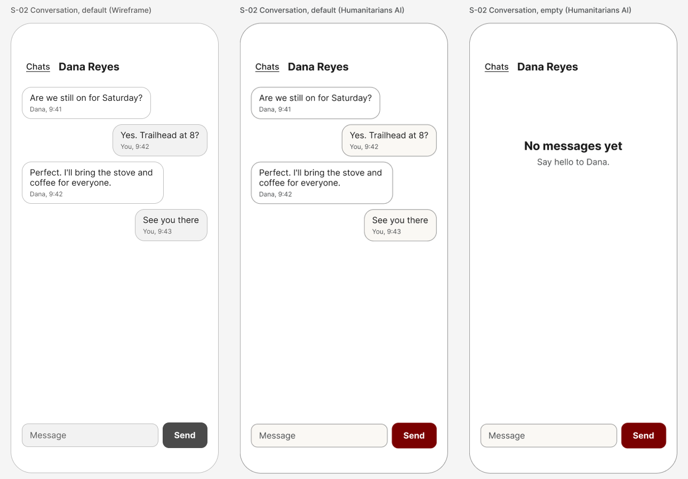

# Tutorial: design a chat app

You will design the first screen of a small iPhone app, a chat app, by talking to Claude. It teaches a conversation, a text box that stays reachable, and telling two speakers apart without color.

This is the general tutorial ([tutorial/README.md](../../README.md), seven steps) with a head start: an example brief and a proposed screen map, so you can get to a drawing in a few minutes and spend your time changing it.

## Start

```bash
./fad init "Hello Chat" --tutorial chat
```

Use your own name for the app. Add `--palette brutalist` (or `northeastern`, `humanitarians`) to start in other colors; the pictures here are in Humanitarians AI. Then open Claude Code in this folder and type `tutorial`.

The command writes the example brief into your design folder and puts the screen map beside it as a proposal. Nothing is drawn until you have read the brief back, changed what you want, and said who may approve.

## The example brief

- **What it is:** One-to-one messages between people who already know each other.
- **Who uses it:** Two friends making a plan
- **What a person must be able to do:**
  1. Read the latest messages in a conversation
  2. Send a message
  3. Find the conversation with a particular person

Change any of it. A different app is a better tutorial than this one.

## The proposed screens

| Screen | What a person does there | States to draw | Leads to |
|---|---|---|---|
| S-01 Chats (start) | See your conversations, newest first | default, empty, loading, error | S-02 Conversation, S-03 New message |
| S-02 Conversation | Read and send messages with one person | default, empty, loading, error | S-01 Chats, S-04 Person |
| S-03 New message | Choose who to write to | default, empty | S-01 Chats, S-02 Conversation |
| S-04 Person | See who you are talking to; mute or block them | default | S-02 Conversation |

`./fad screens` checks the map once you have confirmed it. The first screen to draw is **S-02 Conversation**: it is not the start screen, but it is where this kind of app is won or lost.

## The first screen: S-02 Conversation



Left to right: the wireframe in greys, the same screen in Humanitarians AI, and a second state. The wireframe and the styled screen are the same drawing; only the frame's color mode differs.

What is on it:

- A way back ("Chats") and the name of the person.
- Messages they sent on the left, yours on the right. Each one says who and when in words.
- The two kinds of bubble differ by side and by label, and only slightly by shade, so the screen still reads in greys.
- A text box and a "Send" button at the bottom, above the home indicator. "Send" is the one thing that carries the accent.
- The empty state invites the first message and keeps the text box.

## Things to ask for

Each of these is a real request to type in step 5. Claude records your words, makes the change, and says what changed.

- "Make my messages red like the Send button." It will say that the accent is for the one main action, show you both versions, and draw the one you pick.
- "Where does the text box go when the keyboard is up?" Not drawn yet. Ask for the keyboard-open state: it is the layout people actually type in.
- "What if a message fails to send?" The error state is in the screen map. It needs words, not just a red mark.
- "Draw the list of chats next." S-01 in the screen map. It reuses the list row already in the kit.
- "Make the timestamps smaller." They are 12 points now. The floor on iPhone is 11; it will tell you how close you are.

## What the check found

This is what the measuring step returned for the styled screen when this tutorial was drawn (2026-11-10). Yours will differ as soon as you change something.

- 3 things to tap: "Chats" at 61 by 44 points, the text box at 256 by 44, and "Send" at 84 by 48. All meet the 44-point guidance.
- Smallest text: 12 points (who and when, under each message). The floor is 11.
- Faintest text: 8.03:1. It needs 4.5:1.
- Every color is a variable. Nothing sits under the status bar or the home indicator.
- Clean. The interesting questions here are the ones the check cannot answer: the keyboard, and a failed message.

## Templates to look at

`./fad templates chat` lists every one for this kind of app. A few to start with, each under an open licence:

**Design files (open in Figma):**

- [Text Chat Bubbles UI Kit](https://www.figma.com/community/file/1363554871805689478/text-chat-bubbles-ui-kit-for-figma) by Edwin Zainudin. CC-BY-4.0: you may use and adapt it if you credit the author.
- [Messaging - Chatbox App Design](https://www.figma.com/community/file/1171349248796492917/messaging-chatbox-app-design) by Benzatine Infotech. CC-BY-4.0: you may use and adapt it if you credit the author.

**Code (for whoever builds it):**

- [exyte/Chat](https://github.com/exyte/Chat) (swiftui). MIT: you may build from it; keep its licence notice. SwiftUI chat UI framework with customisable message cells and a media picker; use as a ready chat screen.
- [QuickBirdEng/SwiftUI-Architectures](https://github.com/QuickBirdEng/SwiftUI-Architectures) (swiftui). MIT: you may build from it; keep its licence notice. The same chat app implemented three ways in SwiftUI (Model-View, Redux, MVVM).
- [android/compose-samples / Jetchat](https://github.com/android/compose-samples/tree/main/Jetchat) (compose). Apache-2.0: you may build from it; keep its licence notice. Jetchat: Google's sample chat app focused on UI state patterns and text input, Material 3.
- [FaridSafi/react-native-gifted-chat](https://github.com/FaridSafi/react-native-gifted-chat) (react-native). MIT: you may build from it; keep its licence notice. Complete chat UI for React Native; a ready message-list and composer screen.

Read a template for how its screens are organised. Do not copy its screens as your design: yours comes from your brief. If the builder starts from a code template, its licence notice and credit go in the handoff brief. Open the licence yourself before building on one.

## What was and was not done to make this tutorial

- **Done:** the screens in the picture were drawn in Figma by this tool, from the kit's components, and measured. The numbers above are from that run.
- **Not done:** the loading and error states of this screen, and every other screen in the map. Nobody has walked this tutorial from step 1 to step 7 yet.
