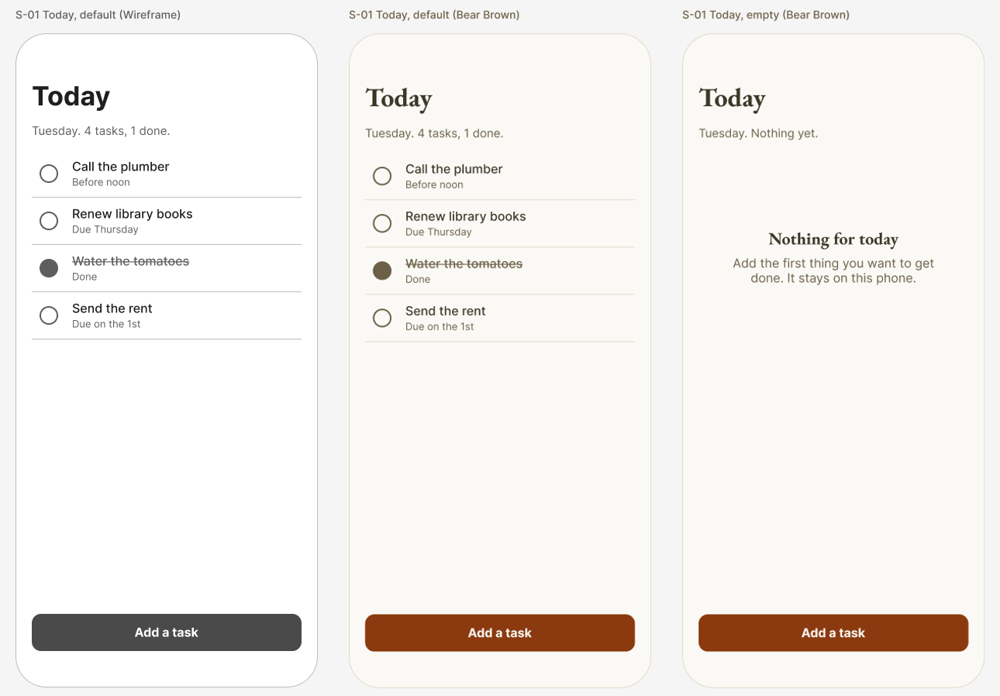

# Tutorial: design a to-do list

You will design the first screen of a small iPhone app, a to-do list, by talking to Claude. It teaches lists, the empty state, and how big a thing to tap must be.

This is the general tutorial ([tutorial/README.md](../../README.md), seven steps) with a head start: an example brief and a proposed screen map, so you can get to a drawing in a few minutes and spend your time changing it.

## Start

```bash
./fad init "Today List" --tutorial to-do
```

Use your own name for the app. Add `--palette brutalist` (or `northeastern`, `humanitarians`) to start in other colors; the pictures here are in Bear Brown. Then open Claude Code in this folder and type `tutorial`.

The command writes the example brief into your design folder and puts the screen map beside it as a proposal. Nothing is drawn until you have read the brief back, changed what you want, and said who may approve.

## The example brief

- **What it is:** A short list of what to get done today, for one person, kept on the phone.
- **Who uses it:** Someone with a handful of things to do today and no patience for setup
- **What a person must be able to do:**
  1. See what is left to do today
  2. Add a task in a few seconds
  3. Mark a task done

Change any of it. A different app is a better tutorial than this one.

## The proposed screens

| Screen | What a person does there | States to draw | Leads to |
|---|---|---|---|
| S-01 Today (start) | See what is left today and tick things off | default, empty | S-02 Add a task, S-03 Task, S-04 Finished |
| S-02 Add a task | Type a task and, if you want, when it is due | default, error | S-01 Today |
| S-03 Task | Change a task or delete it | default | S-01 Today |
| S-04 Finished | Look back at what you got done | default, empty | S-01 Today |

`./fad screens` checks the map once you have confirmed it. The first screen to draw is **S-01 Today**.

## The first screen: S-01 Today



Left to right: the wireframe in greys, the same screen in Bear Brown, and a second state. The wireframe and the styled screen are the same drawing; only the frame's color mode differs.

What is on it:

- The title "Today" and one line that says how much is left.
- One row per task: a 44 by 44 point check area, the task, and a short note such as when it is due.
- A finished task is struck through and says "Done", so it does not depend on color.
- One main button, "Add a task", at the bottom where a thumb reaches it.
- The empty state says what the screen is for and still offers the button.

## Things to ask for

Each of these is a real request to type in step 5. Claude records your words, makes the change, and says what changed.

- "Make the check circles smaller, they look heavy." The circle can shrink; the area you tap cannot go under 44 points on iPhone. Claude will say so, offer a small circle inside a 44-point area, and draw what you choose.
- "Put the add button at the top instead." It will move it and tell you the trade: the top of a tall phone is the hardest place for a thumb to reach.
- "Show finished tasks in green." A color of your own is a new variable, with its contrast worked out first. And color alone cannot be the only sign a task is done.
- "Show me this in Northeastern colors." No redraw: it duplicates the frame and switches the frame's color mode.
- "What does this look like with 40 tasks?" A good question to ask of any list. It draws the long version so you can see what scrolls and what stays put.

## What the check found

This is what the measuring step returned for the styled screen when this tutorial was drawn (2026-11-10). Yours will differ as soon as you change something.

- 5 things to tap: four check areas at 44 by 44 points and the button at 348 by 48. All meet the 44-point guidance.
- Smallest text: 13 points (the notes under each task). The floor is 11.
- Faintest text: the secondary text, 5.88:1 against the cream ground. It needs 4.5:1.
- Every color is a variable. Nothing sits under the status bar or the home indicator.
- So this screen came back clean. Ask for the smaller check circles and watch the check catch it.

## Templates to look at

`./fad templates to-do` lists every one for this kind of app. A few to start with, each under an open licence:

**Design files (open in Figma):**

- [Task management and to-do list app](https://www.figma.com/community/file/1143575071825582037/task-management-to-do-list-app) by Neser U.. CC-BY-4.0: you may use and adapt it if you credit the author.
- [Todo Mobile App (Community)](https://www.figma.com/community/file/1175913608782916573) by Jenelle Miller. CC-BY-4.0: you may use and adapt it if you credit the author.

**Code (for whoever builds it):**

- [pointfreeco/swift-composable-architecture / Examples/Todos](https://github.com/pointfreeco/swift-composable-architecture/tree/main/Examples/Todos) (swiftui). MIT: you may build from it; keep its licence notice. Todos example inside the Composable Architecture repo: a simple to-do list with filtering, reordering and auto-sorting of completed items.
- [peterfriese/MakeItSo](https://github.com/peterfriese/MakeItSo) (swiftui). Apache-2.0: you may build from it; keep its licence notice. Sample app that replicates the iOS Reminders app with SwiftUI and Firebase (Firestore, sign-in).
- [android/architecture-samples](https://github.com/android/architecture-samples) (compose). Apache-2.0: you may build from it; keep its licence notice. Google's reference TODO app, rebuilt in Jetpack Compose with one screen and ViewModel per feature; other branches show the same app with different architectures.

Read a template for how its screens are organised. Do not copy its screens as your design: yours comes from your brief. If the builder starts from a code template, its licence notice and credit go in the handoff brief. Open the licence yourself before building on one.

## What was and was not done to make this tutorial

- **Done:** the screens in the picture were drawn in Figma by this tool, from the kit's components, and measured. The numbers above are from that run.
- **Not done:** every other screen in the map. Nobody has walked this tutorial from step 1 to step 7 yet.
