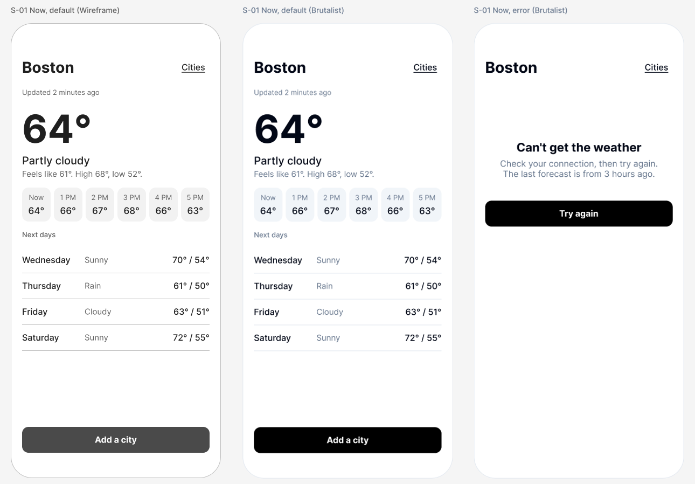

# Tutorial: design a weather app

You will design the first screen of a small iPhone app, a weather app, by talking to Claude. It teaches showing numbers at a glance, and what a screen says when it has no data.

This is the general tutorial ([tutorial/README.md](../../README.md), seven steps) with a head start: an example brief and a proposed screen map, so you can get to a drawing in a few minutes and spend your time changing it.

## Start

```bash
./fad init "Sky Today" --tutorial weather
```

Use your own name for the app. Add `--palette brutalist` (or `northeastern`, `humanitarians`) to start in other colors; the pictures here are in Brutalist. Then open Claude Code in this folder and type `tutorial`.

The command writes the example brief into your design folder and puts the screen map beside it as a proposal. Nothing is drawn until you have read the brief back, changed what you want, and said who may approve.

## The example brief

- **What it is:** Today's weather and the next few days for the places you care about, readable at a glance.
- **Who uses it:** Someone deciding what to wear or whether to go out, looking for five seconds
- **What a person must be able to do:**
  1. See the weather right now where I am
  2. See what the next hours and days look like
  3. Check another city

Change any of it. A different app is a better tutorial than this one.

## The proposed screens

| Screen | What a person does there | States to draw | Leads to |
|---|---|---|---|
| S-01 Now (start) | See the weather right now and the next hours and days | default, loading, error | S-02 Cities, S-03 Add a city, S-04 Day, S-05 Where are you? |
| S-02 Cities | Switch to another saved place | default, empty | S-01 Now, S-03 Add a city |
| S-03 Add a city | Search for a place and save it | default, empty, loading, error | S-01 Now, S-02 Cities |
| S-04 Day | See one day hour by hour | default | S-01 Now |
| S-05 Where are you? | Share your location or type a city instead | default | S-01 Now, S-03 Add a city |

`./fad screens` checks the map once you have confirmed it. The first screen to draw is **S-01 Now**.

## The first screen: S-01 Now



Left to right: the wireframe in greys, the same screen in Brutalist, and a second state. The wireframe and the styled screen are the same drawing; only the frame's color mode differs.

What is on it:

- The city, and when the numbers were last updated.
- The temperature, very large, then the condition in words and a line with feels-like, high and low.
- Six hours in a row, then four days in a list. Conditions are words, not pictures, so nothing depends on recognising an icon.
- One main button, "Add a city". "Cities" is a quieter, underlined control, 44 points high.
- The error state says what went wrong, how old the last forecast is, and offers "Try again".

## Things to ask for

Each of these is a real request to type in step 5. Claude records your words, makes the change, and says what changed.

- "Make the hour labels darker." This is the fix for what the check found (below). It switches those labels to the main text color.
- "Add little weather icons." It will ask where the icons come from: an icon set has a licence, and an icon never replaces the word.
- "What does it show while it is loading?" The loading state is in the screen map and not drawn yet. Ask for it.
- "Use Fahrenheit and Celsius." A fact about the app. It goes in the brief, and the screen gets a way to switch.
- "Show me this in dark mode." Brutalist has a dark mode, so this is a switch of the frame's mode.

## What the check found

This is what the measuring step returned for the styled screen when this tutorial was drawn (2026-11-10). Yours will differ as soon as you change something.

- 2 things to tap: "Cities" at 60 by 44 points and the button at 348 by 48. Both meet the 44-point guidance.
- Smallest text: 13 points. The floor is 11.
- **One failure.** The six hour labels ("Now", "1 PM", ...) are slate grey on the slate card: 4.34:1. Body text needs 4.5:1 (WCAG 2.2, 1.4.3).
- That is the same pairing `./fad palettes brutalist` marks LOW before anything is drawn. The palette warned; the drawing used it anyway; the check caught it.
- The picture above still shows the faint labels. Fixing them is your first request.

## Templates to look at

`./fad templates weather` lists every one for this kind of app. A few to start with, each under an open licence:

**Design files (open in Figma):**

- [Weather App UI Design](https://www.figma.com/community/file/1100826294536456295) by Aksonvady. CC-BY-4.0: you may use and adapt it if you credit the author.
- [Weather Forecast App](https://www.figma.com/community/file/885501292477669105) by Farhan. CC-BY-4.0: you may use and adapt it if you credit the author.

**Code (for whoever builds it):** no maintained SwiftUI weather app with an open licence turned up, so these are Flutter and Kotlin.

- [bizz84/open_weather_example_flutter](https://github.com/bizz84/open_weather_example_flutter) (flutter). MIT: you may build from it; keep its licence notice. Flutter weather app example using the OpenWeatherMap API.
- [odaridavid/WeatherApp](https://github.com/odaridavid/WeatherApp) (kmp). Apache-2.0: you may build from it; keep its licence notice. Kotlin Multiplatform weather app with Compose UI, MVI and location services.
- [jhomlala/feather](https://github.com/jhomlala/feather) (flutter). Apache-2.0: you may build from it; keep its licence notice. Feather: Flutter weather application.

Read a template for how its screens are organised. Do not copy its screens as your design: yours comes from your brief. If the builder starts from a code template, its licence notice and credit go in the handoff brief. Open the licence yourself before building on one.

## What was and was not done to make this tutorial

- **Done:** the screens in the picture were drawn in Figma by this tool, from the kit's components, and measured. The numbers above are from that run.
- **Not done:** the loading state of this screen, and every other screen in the map. Nobody has walked this tutorial from step 1 to step 7 yet.
